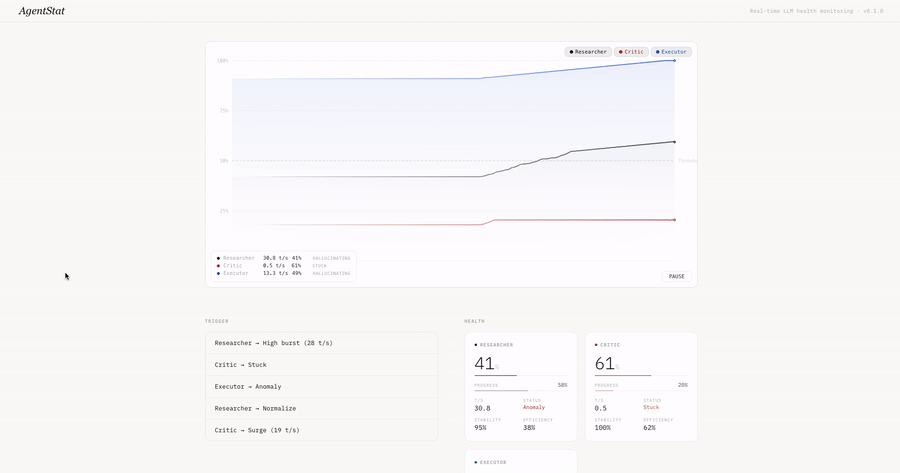

# AgentStat

[](https://www.npmjs.com/package/@dan-build/agentstat)
[](https://bundlephobia.com/package/@dan-build/agentstat)
[](https://www.npmjs.com/package/@dan-build/agentstat)
[](./LICENSE)

**Live telemetry for LLM agents, rendered honestly.**

A React component that shows what your agents are doing right now: token rate,
progress and status over time, a health score built only from signals you
actually provide, and opt-in detection of stalls, runaway spikes and status
thrashing. One canvas, about 16 KB min+gzip, no dependencies besides React.



---

## Quick start

```bash
npm install @dan-build/agentstat
```

```tsx
'use client';
import { AgentStat, demoAgents } from '@dan-build/agentstat';

export default function Demo() {
  return <AgentStat agents={demoAgents} simulateData height={400} />;
}
```

`simulateData` drives the chart with demo data, so you can check the install
before wiring anything. Pass `simulateData={{ seed: 1 }}` for a reproducible run
(screenshots, visual tests).

## Your own agents

The `agents` prop is the roster — which agents exist and in what order. Live
values arrive through the ref:

```tsx
'use client';
import { useMemo, useRef } from 'react';
import { AgentStat, createAgent, type AgentStatRef } from '@dan-build/agentstat';

export default function Monitor() {
  const ref = useRef<AgentStatRef>(null);
  const agents = useMemo(() => [createAgent('planner', 'Planner'), createAgent('coder', 'Coder')], []);

  // From your telemetry source (stream callbacks, WebSocket, SSE, MCP, …):
  // ref.current?.updateAgent('planner', { tokensRate: 18.4, status: 'active' });

  return <AgentStat ref={ref} agents={agents} metric="tokens" anomalyDetection height={420} />;
}
```

`updateAgent` takes a partial sample, so report only what changed:

```ts
ref.current?.updateAgent('planner', { tokensRate: 18.4 });
ref.current?.updateAgent('planner', { status: 'thinking' });
ref.current?.updateAgent('planner', { latencyMs: 820, progress: 40 });
```

The positional form `updateAgent(id, tokensRate, progress, status)` still works.

Input is validated: `NaN`, `Infinity`, unknown statuses and unknown ids are
ignored with a one-time console warning instead of breaking the chart.

Changing `name`, `color`, `config` or `visible` on an existing agent in the
`agents` prop is applied. Passing a new array with the same agents on every
render is fine.

### Vercel AI SDK

[`examples/vercel-ai-sdk.tsx`](./examples/vercel-ai-sdk.tsx) wires `useChat`
(AI SDK v5+). It maps the chat `status` to agent status and measures the token
rate from the streamed text over a sliding 1-second window. It also keeps
sampling while a response is in flight, so a stream that goes quiet shows up as
a stall.

More integrations — LangChain, WebSocket/SSE, MCP — are in the
[integration guide](https://agentstat.sdaniel.cc/docs/real-data-integration/).

---

## What you see

- **Lines over time** for progress (`metric="progress"`, the default), token rate
  (`"tokens"`), or both on two axes (`"both"`). Time is labelled relative to now.
- **A live tip** at the right edge for agents that are reporting. An agent that
  stops reporting keeps its line where its data ends; nothing is extrapolated.
- **A legend** to show or hide agents. Hidden agents are still monitored.
- **A panel** with each agent's rate, health and status (text and icon, not
  color alone).
- **Hover or keyboard inspection** of any sample, with its age, rate, progress
  and the status it had at that moment.

With no `windowSeconds`, the chart shows up to the last 10 s, anchored to the
newest sample. Set `windowSeconds` (e.g. `60`, `300`, `900`) for a longer
wall-clock window; long windows are downsampled to the canvas resolution.

## Anomaly detection

```tsx
<AgentStat
  agents={agents}
  anomalyDetection
  onAnomaly={(agentId, anomaly) => console.warn(agentId, anomaly.message)}
/>
```

| Kind | Meaning | How it's detected |
|------|---------|-------------------|
| **stall** | Claims to be working (`active` / `thinking`) but isn't producing — a hung tool call, a dropped stream. | Token rate near zero for `stallDurationMs`, **or** no data at all for that long. |
| **spike** | A runaway loop burning tokens far above normal. | Outlier (z-score) against the agent's own baseline. |
| **thrash** | Flipping between states. | `thrashChangeCount` status changes within `thrashWindowMs`. |

Each anomaly carries the numbers that triggered it (`stalled 8s while active`,
`token spike 80/s (3.2σ above ~10/s)`).

- **Markers:** warning = ▲ amber, critical = ◆ red. Each marker shows the agent's
  name.
- **Screen readers:** new anomalies are announced through a live region.
- **`onAnomaly`:** fires once when an anomaly starts, and once more if it
  escalates to critical — not on every check.
- **Thresholds:** tune them with `anomalyConfig`. They're sensible defaults, not
  calibrated on real agent traces.

```tsx
<AgentStat agents={agents} anomalyDetection anomalyConfig={{ stallDurationMs: 3000, spikeZScore: 4 }} />
```

The detector also works without the chart:

```ts
import { detectAnomalies } from '@dan-build/agentstat';
const found = detectAnomalies(tokenSamples, statusChanges, 'active', performance.now());
```

## Health score

`onHealthChange` and `ref.getHealth(id)` return:

| Field | Meaning |
|-------|---------|
| `score` | 0–100 composite over the components below that have data, minus penalties for active anomalies. |
| `tokenEfficiency` | How close the recent average rate is to `config.expectedTokensPerSec` (100 = inside the band). |
| `stability` | Steadiness of the token rate relative to its own level. |
| `hallucinationRisk` | **Only from your signal**: `1 − confidenceScore` if you pass one, 100 while you report status `'hallucinating'`, otherwise `null`. Telemetry can't detect hallucinations. |
| `latencyTrend` | Direction of the `latencyMs` you report (`improving` / `stable` / `degrading`), `null` until there are four samples. |

---

## API

### Props

| Prop | Type | Default | |
|------|------|---------|---|
| `agents` | `Agent[]` | `[]` | The roster. |
| `height` | `number \| string` | `520` | Any CSS length. Width is always 100%. |
| `metric` | `'progress' \| 'tokens' \| 'both'` | `'progress'` | Which series to plot. |
| `windowSeconds` | `number` | — | Wall-clock window. Unset: last 10 s of data. |
| `theme` | `'light' \| 'dark' \| 'system'` | inferred | Unset: dark if `styles.background` is dark. |
| `styles` | `{ background, borderColor, textColor, gridColor }` | — | Any CSS color, including `var(--token)`. |
| `tokenAxisMax` | `number` | auto | Pin the token axis. Auto rises instantly, eases down slowly. |
| `referenceLine` | `{ value, label?, color? }` | — | Against the left axis. |
| `smoothing` | `number` in `[0, 1)` | `0` | Display-only; damps spikes on screen, never in data. |
| `anomalyDetection` | `boolean` | `false` | |
| `anomalyConfig` | `Partial<AnomalyConfig>` | — | Merged over `DEFAULT_ANOMALY_CONFIG`. |
| `onAnomaly` | `(id, anomaly) => void` | — | Once per anomaly, plus escalation. |
| `onHealthChange` | `(id, health) => void` | — | When the score or a signal changes. |
| `onPointClick` | `(id, point) => void` | — | Click or Enter on a sample. |
| `simulateData` | `boolean \| { seed?: number }` | `false` | Demo data. |
| `maxHistoryPoints` | `number` | `100000` | Memory cap per series; retention is time-based. |
| `ariaLabel` | `string` | generated | Accessible name of the chart. |
| `className`, `style` | | — | Applied to the root. |

### Ref

```ts
interface AgentStatRef {
  updateAgent(id: string, sample: AgentSample): void;
  updateAgent(id: string, tokensRate: number, progress: number, status: AgentStatus): void;
  getHealth(id: string): HealthMetrics | undefined;
  getAnomalies(id: string): Anomaly[];
  getLiveMetrics(id: string): { tokensRate: number; progress: number; status: AgentStatus } | undefined;
}

type AgentSample = {
  tokensRate?: number;
  progress?: number;        // 0–100
  status?: AgentStatus;     // 'active' | 'thinking' | 'stuck' | 'complete' | 'hallucinating'
  latencyMs?: number;       // enables latencyTrend
  confidenceScore?: number; // 0–1, enables hallucinationRisk
  errorCount?: number;
};
```

### Agent

```ts
type Agent = {
  id: string;
  name: string;
  color?: string;          // any CSS color; omit to use the theme palette
  current: { tokensRate: number; progress: number; status: AgentStatus };
  config?: { expectedTokensPerSec?: [number, number] };
  visible?: boolean;       // initial visibility, default true
};
```

`createAgent(id, name, color?)` builds one with zeroed values.

---

## Theming

Light and dark themes ship built in. All text clears WCAG AA contrast, and the
default series palette is hue-distinct and at least 3:1 against both
backgrounds. Use `theme="system"` to follow the OS, or `styles` to match your
surface:

```tsx
<AgentStat agents={agents} theme="dark" styles={{ background: 'var(--surface-1)' }} />
```

Omit `color` on agents to use the palette, which switches with the theme.

## Accessibility

- **The chart:** a focusable image whose description summarizes every visible
  agent (status, rate, health).
- **Keyboard:** <kbd>←</kbd>/<kbd>→</kbd> step through samples, <kbd>↑</kbd>/<kbd>↓</kbd>
  switch agent, <kbd>Home</kbd>/<kbd>End</kbd> jump, <kbd>Enter</kbd> activates
  the sample, <kbd>Esc</kbd> clears, <kbd>Space</kbd> pauses.
- **Controls:** legend chips and Pause are toggle buttons (`aria-pressed`) with
  visible focus rings and 24 px targets.
- **Announcements:** anomalies go to a polite live region, and critical ones to
  an alert region.
- **Reduced motion:** with `prefers-reduced-motion`, the live dot stops pulsing,
  values snap instead of easing, and controls don't scale on press.
- **Not color alone:** status and severity are always paired with text, icons
  or marker shapes.

## Framework notes

- **Next.js App Router:** the build ships with `'use client'`, so you can import
  it from server components. It server-renders the legend and panel, then draws
  on the client.
- **React:** 18 and 19.
- **Modules:** ESM and CommonJS, typed for both.
- **Tree-shaking:** importing only `detectAnomalies` adds about 1 KB.

## Browser support

Evergreen browsers from 2022 on: Chrome/Edge 94+, Firefox 93+, Safari 15.4+.

## Documentation

- [Overview](https://agentstat.sdaniel.cc/docs/overview/)
- [Real data integration](https://agentstat.sdaniel.cc/docs/real-data-integration/)
- [API reference](https://agentstat.sdaniel.cc/docs/api-reference/)
- [Examples](https://agentstat.sdaniel.cc/docs/examples/)

## Contributing

See [CONTRIBUTING.md](./CONTRIBUTING.md). Security issues: [SECURITY.md](./SECURITY.md).

## License

MIT © [dan-build](https://github.com/dan-build)
